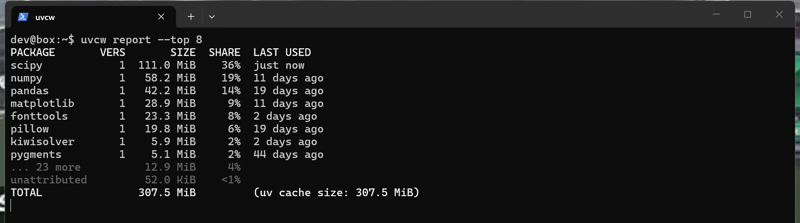
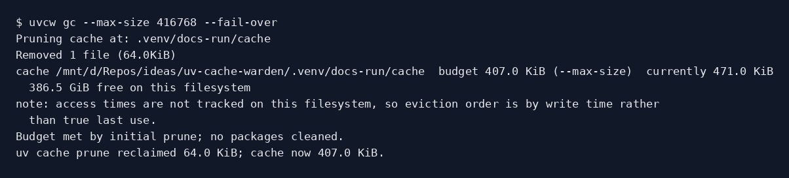
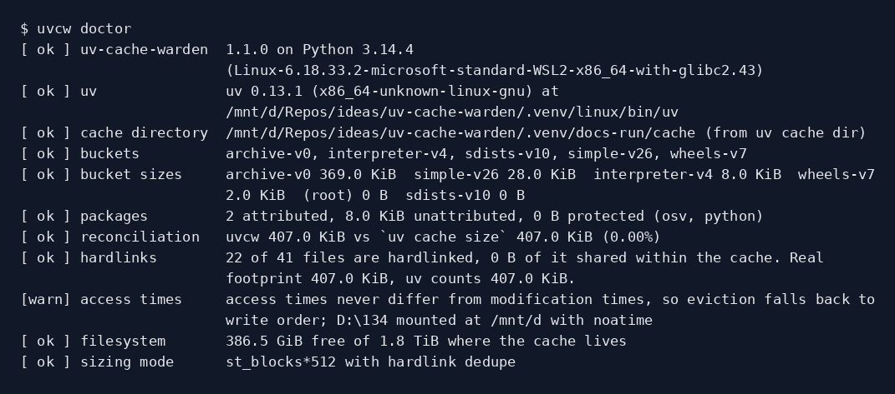

# uv-cache-warden

Keep [uv](https://docs.astral.sh/uv/)'s package cache under a size budget, with least-recently-used eviction. Dependency-free Python CLI (`uvcw`) plus a GitHub Action.



## The problem

uv's cache grows and never shrinks on its own. [astral-sh/uv#5731](https://github.com/astral-sh/uv/issues/5731) has been open since August 2024 with 53 reactions and 31 comments; people report caches at 99 GB, 140 GB, 150 GB, 200 GiB and, at NVIDIA, "routinely exceeding 1TB+". uv ships `uv cache size`, `uv cache clean [PACKAGE]` and `uv cache prune`, and [none of them takes a size or age argument](https://docs.astral.sh/uv/reference/cli/). `uv cache prune` only removes entries it considers unused, which is why [#16551](https://github.com/astral-sh/uv/issues/16551) (multi-GB of CUDA wheels left behind after `uv tool uninstall`) was closed as not planned.

So the workaround people write by hand is: measure the cache, work out what to drop, call `uv cache clean` per package, prune. That is what this does, properly.

The open upstream PR, [#20116](https://github.com/astral-sh/uv/pull/20116), makes `uv cache prune` run itself. That helps the long-lived server case, but prune only removes archives nothing links to, and the caches above are full of old versions that are still linked. A budget over referenced packages stays an external job.

uv's docs say it is [never safe to modify the cache directly](https://docs.astral.sh/uv/concepts/cache/). uv-cache-warden never unlinks a file. Every deletion is a `uv cache clean <package>` or one final `uv cache prune`, and it never passes uv's `--force`, so uv keeps blocking on the cache lock the way it is designed to.

## Install

```console
$ uv tool install uv-cache-warden
$ uvcw --version
uvcw 1.0.1
```

Or run it without installing:

```console
$ uvx uv-cache-warden report
```

`pip install uv-cache-warden` and `pipx install uv-cache-warden` work too. Python 3.9 or newer, no runtime dependencies.

## Usage

### `uvcw report`

```console
$ uvcw report --top 8
PACKAGE       VERS       SIZE  SHARE  LAST USED
scipy            1  106.0 MiB    43%  21 minutes ago
numpy            1   41.1 MiB    17%  3 days ago
pandas           1   34.6 MiB    14%  31 days ago
matplotlib       1   22.9 MiB     9%  14 days ago
pillow           1   14.8 MiB     6%  14 days ago
fonttools        1   12.1 MiB     5%  31 days ago
pygments         1    4.5 MiB     2%  47 days ago
pytest           1    1.4 MiB    <1%  3 days ago
... 26 more          10.2 MiB     4%
unattributed         36.1 KiB    <1%
TOTAL               247.7 MiB         (uv cache size: 247.7 MiB)

note: Access times on this filesystem never differ from modification times (noatime?), so LAST USED
  reflects when an entry was written.
```

On a terminal the table stops at 20 rows so the header stays on screen. `--all` shows everything, and piped output is never truncated. That closing note is a real filesystem fact, not boilerplate: Windows disables NTFS last-access updates by default, so on this machine LRU falls back to write order, and `uvcw doctor` names the registry value responsible.

`--sort age` reorders the table coldest-first, which is the order `gc` evicts in, so it previews what a budget would take:

```console
$ uvcw report --sort age --top 5
PACKAGE          VERS       SIZE  SHARE  LAST USED
colorama            1  108.8 KiB    <1%  63 days ago
python-dateutil     1  451.2 KiB    <1%  63 days ago
requests            1  298.8 KiB    <1%  63 days ago
httpx               1  330.7 KiB    <1%  47 days ago
pygments            1    4.5 MiB     2%  47 days ago
... 29 more            242.0 MiB    98%
unattributed            36.1 KiB    <1%
TOTAL                  247.7 MiB         (uv cache size: 247.7 MiB)
```

`--json` gives the same data with per-package `disk_bytes`, `physical_bytes`, `reclaim_bytes`, `age_seconds`, a bucket inventory and the reconciliation delta against `uv cache size`. `--json-file PATH` writes that alongside the table instead of replacing it, which is what you want in a CI log.

### `uvcw gc`



A dry run changes nothing and shows exactly what the real run would do:

```console
$ uvcw gc --max-size 150MB --min-age 7d --dry-run
cache D:\tmp\uvcw-live  budget 143.1 MiB (--max-size)  currently 247.7 MiB
  489.6 GiB free on this filesystem
note: access times are not tracked on this filesystem, so eviction order is by write time rather
  than true last use.

would evict (18 of 34 packages):
  colorama            108.8 KiB  63 days ago
  python-dateutil     451.2 KiB  63 days ago
  requests            298.8 KiB  63 days ago
  ...
  anyio               557.3 KiB  9 days ago
  httpcore            329.5 KiB  9 days ago

dry run: nothing was removed. Projected 247.7 MiB -> 153.0 MiB (budget 143.1 MiB).
projected: still over budget by 10.0 MiB.
  153.0 MiB held back by packages used within --min-age
  36.1 KiB is unattributed (no package name to pass to `uv cache clean`); only `uv cache prune` can touch it
```

That plan falls short of the budget, and the run says so up front rather than leaving you to compare the two numbers. `--fail-over` turns it into exit 2. Relaxing `--min-age` lets it through:

```console
$ uvcw gc --max-size 150MB --min-age 3d --fail-over
Removed 22 files (100.8KiB)
Removed 30 files (447.2KiB)
...
Removed 1066 files (40.9MiB)
Pruning cache at: D:\tmp\uvcw-live
No unused entries found
cache D:\tmp\uvcw-live  budget 143.1 MiB (--max-size)  currently 247.7 MiB
  489.6 GiB free on this filesystem

evicted (20 of 34 packages):
  colorama            108.8 KiB  63 days ago
  ...
  numpy                41.1 MiB  3 days ago

reclaimed 136.3 MiB; cache now 111.4 MiB (budget 143.1 MiB); evicted 20 packages
under budget.
```

The `Removed ...` and `Pruning cache at:` lines come from uv itself, streamed through as they happen so a wait on the cache lock is visible while it is still happening.

Already under budget is a no-op that exits 0:

```console
$ uvcw gc --max-size 10GB
cache D:\tmp\uvcw-live  budget 9.3 GiB (--max-size)  currently 111.4 MiB
  489.6 GiB free on this filesystem
Already under budget (111.4 MiB <= 9.3 GiB). Nothing to do.
```

`--min-free` budgets against the filesystem rather than the cache, which is what a runner that keeps filling its disk actually wants. To leave 500 GB free on a disk with 489.6 GiB spare, the cache has to give back the shortfall:

```console
$ uvcw gc --min-free 500GB --dry-run
cache D:\tmp\uvcw-live  budget 104.7 MiB (--min-free)  currently 247.7 MiB
  489.6 GiB free on this filesystem
```

Give both and the tighter one wins; the header always names which constraint is binding. Even with nothing evictable, `gc` still runs `uv cache prune` once when the cache is over budget, because unreferenced archive bytes are reclaimable only there. That is the [#16551](https://github.com/astral-sh/uv/issues/16551) case.

### `uvcw doctor`



```console
$ uvcw doctor
[ ok ] uv-cache-warden  1.0.1 on Python 3.12.10 (Windows-11-10.0.26200-SP0)
[ ok ] uv               uv 0.12.9 (9f9286029 2026-09-01 x86_64-pc-windows-msvc) at
                        D:\tmp\uvcw-venv\Scripts\uv.EXE
[ ok ] cache directory  D:\tmp\uvcw-live (from uv cache dir)
[ ok ] buckets          archive-v0, interpreter-v4, sdists-v9, simple-v24, wheels-v6
[ ok ] bucket sizes     archive-v0 241.2 MiB  simple-v24 6.5 MiB  wheels-v6 57.4 KiB  (root) 8.0 KiB
                        interpreter-v4 4.0 KiB  sdists-v9 0 B
[ ok ] packages         34 attributed, 36.1 KiB unattributed, 0 B protected (osv, python)
[ ok ] reconciliation   uvcw 247.7 MiB vs `uv cache size` 247.7 MiB (0.00%)
[ ok ] hardlinks        6937 of 7183 files are hardlinked, 0 B of it shared within the cache. Real
                        footprint 247.7 MiB, uv counts 247.7 MiB.
[warn] access times     access times never differ from modification times, so eviction falls back to
                        write order; NtfsDisableLastAccessUpdate=2147483649 (updates disabled)
[ ok ] filesystem       489.6 GiB free of 1.8 TiB where the cache lives
[ ok ] sizing mode      st_size, uv does not dedupe here
```

`doctor` exits 1 if any check fails, so it works as a preflight step.

### Output

Colour is on for terminals and off everywhere else. `NO_COLOR` disables it, `FORCE_COLOR` forces it, `--no-color` does the same per command, and `--json` is never coloured. A scan of a large cache prints a `scanning cache... 62,000 entries` counter on stderr, but only after it has already been running for a second and a half, so quick runs stay silent and piped output stays clean.

## GitHub Action

```yaml
- uses: astral-sh/setup-uv@v10.0.1
- run: uv sync

- uses: Booyaka101/uv-cache-warden@v1
  with:
    max-size: 4GB
    min-age: 3d
    keep: torch
```

Inputs: `max-size`, `min-free`, `min-age`, `keep` (comma-separated), `mode` (`gc`, `dry-run` or `report`), `fail-over`, `cache-dir`, `timeout`, `version`, `summary`.
Outputs: `size-before`, `size-after`, `reclaimed`, `evicted`, `over-budget`, `json-path`. It writes a job summary table by default.

A self-hosted runner that keeps its cache between jobs is the case this exists for:

```yaml
- uses: Booyaka101/uv-cache-warden@v1
  if: always()
  with:
    max-size: 20GB
    min-free: 50GB
```

`version: local` installs from the checkout instead of PyPI, which is how this repository tests its own action.

## Configuration

Flags win; environment variables fill in defaults. There is no config file.

| Variable | Equivalent |
|---|---|
| `UVCW_CACHE_DIR` | `--cache-dir` |
| `UVCW_UV` | `--uv` |
| `UVCW_TIMEOUT` | `--timeout` (seconds, default 900) |
| `UVCW_MAX_SIZE` | `gc --max-size` |
| `UVCW_MIN_FREE` | `gc --min-free` |
| `UVCW_MIN_AGE` | `gc --min-age` |
| `UVCW_KEEP` | `gc --keep`, comma-separated |

Sizes accept `10GB`, `4GiB`, `500MiB` or a bare byte count; decimal units are powers of 1000 and binary units powers of 1024. Durations accept `s`, `m`, `h`, `d`, `w`.

Exit codes: `0` success, `1` uvcw could not do its job (no `uv`, no cache, bad arguments), `2` still over budget and `--fail-over` was given. A package uv refuses to clean is logged, skipped and named in the summary; it does not change the exit code, so use `--fail-over` if you need CI to notice.

The cache directory is found by running `uv cache dir`. If that fails, it falls back to `$UV_CACHE_DIR`, `$XDG_CACHE_HOME/uv`, `~/.cache/uv` and `%LOCALAPPDATA%\uv\cache`, in that order. A directory containing no recognisable uv bucket is refused outright, and so are your home directory and a filesystem root.

## How the numbers work

`uv cache size` delegates to [`diskus`](https://github.com/sharkdp/diskus), so uvcw reproduces diskus exactly and the two totals agree byte for byte:

| | file bytes | directories | hardlink dedupe |
|---|---|---|---|
| Unix | `st_blocks * 512` | counted | yes, by `(dev, ino)` when `nlink > 1` |
| Windows | `st_size` | counted, at their NTFS index allocation | none, [by design](https://github.com/sharkdp/diskus/issues/32) |

The cache directory's own entry counts too, which on NTFS is zero until the directory outgrows its resident index and then jumps to 4 KiB or more.

That number, `disk_bytes`, is what the budget is measured against, because it is the number the user sees. Two others appear in `--json`:

- `physical_bytes`: inode dedupe on *both* platforms. uv 0.12.7 added the `content-addressed-cache` preview feature, which hardlinks identical files within and across cached wheels, so on Windows this can sit well below `disk_bytes`.
- `reclaim_bytes`: uv's own estimate of what removing an entry frees, from `crates/uv-cache/src/removal.rs`: `blocks * 512` when `nlink == 1` and zero otherwise on Unix, `len()` on Windows.

Package attribution comes from uv's own layout. `wheels-*/<kind>/<package>/`, `sdists-*/<kind>/<package>/<version>/` and `simple-*/<kind>/<package>.rkyv` name the package directly. Unpacked wheels sit under `archive-*/<hash>/` with no name, reached by a link from the wheels bucket: a symlink on Unix, and on Windows a small regular file whose content is literally `archive-v0/<id>`. uvcw resolves both, and ignores a link naming a stale archive version, exactly as uv's own `resolve_link` does.

## Limitations

- **Source distributions from a URL, a local path or Git are not attributed.** uv identifies those by reading a msgpack blob inside the entry, and uvcw is stdlib-only. Their bytes land in `unattributed`, which only `uv cache prune` can reclaim. Wheels from an alternate index *are* attributed, because the index layout still puts the package name in the path.
- **An archive referenced by two packages is charged to neither.** `uv cache clean <pkg>` only frees it once every referrer is gone, so attributing it to one of them would promise bytes uvcw cannot deliver.
- **Managed Python interpreters (`python-v0`) and the vulnerability database (`osv-v0`) are never evicted.** They count toward the total and are reported separately as `protected`.
- **Recency ignores the simple-index bucket.** `uv lock` revalidates `simple-*` metadata for every package it resolves, so those files are freshly written even for a package nobody has installed in months. Their bytes count toward a package's size; their timestamps do not move its clock.
- **LRU degrades to write order where access times are not tracked.** Windows disables NTFS last-access updates by default and Linux mounts are commonly `noatime`; `uvcw doctor` and `uvcw gc` both say so when it applies. `last_used` is `max(atime, mtime)`, so it degrades to first-write rather than to nonsense.
- **Strict LRU can evict a lot to reach a little.** Eviction is oldest-first by design, so if the one package standing between you and the budget is also the newest, everything older goes first. The header says how many of your packages that is, and `--dry-run` shows the list before anything happens.
- **Projection is not measurement.** Evicting a package whose bytes are hardlinked to bytes that survive frees less than expected, so `gc` re-measures with `uv cache size` and runs the analysis again (up to three rounds) if it is still over. The printed `reclaimed` figure is always measured, never projected.
- **On a uv too old for `uv cache size`, totals come from our own walk** and there is nothing to cross-check them against. `doctor` warns when that happens.
- No daemon, no config file, no telemetry.

## Development

```console
$ git clone https://github.com/Booyaka101/uv-cache-warden
$ cd uv-cache-warden
$ python -m pip install -e ".[dev]"
$ python -m pytest -q                 # 139 unit tests, no network
$ python -m pytest -q -m integration  # needs uv on PATH and PyPI access
```

The unit tests build synthetic cache trees matching `crates/uv-cache/src/lib.rs` and use a recording fake in place of the uv wrapper. The fake lives in `tests/conftest.py` and nothing under `src/` imports it.

`PHASE0.md` records every upstream fact this tool relies on, with the quote and the URL, so it can be rechecked when uv changes.

## Distribution

The first place to post this is [astral-sh/uv#5731](https://github.com/astral-sh/uv/issues/5731) itself. It is an open, `help wanted` issue with 31 comments of people describing exactly this workaround by hand, and a comment there reaches everyone already subscribed to the problem.

## License

MIT.
